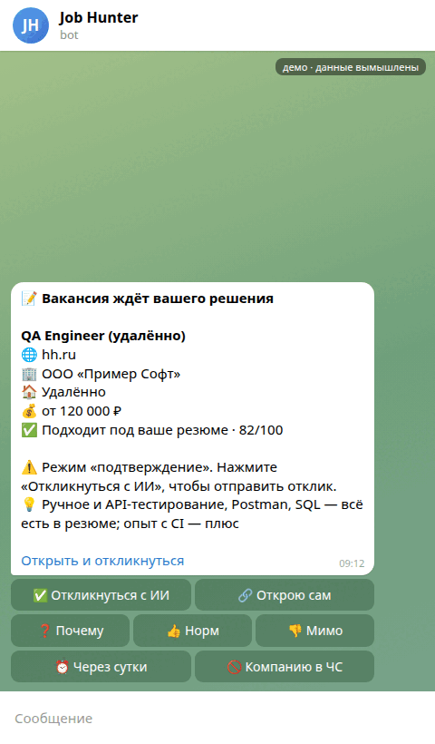
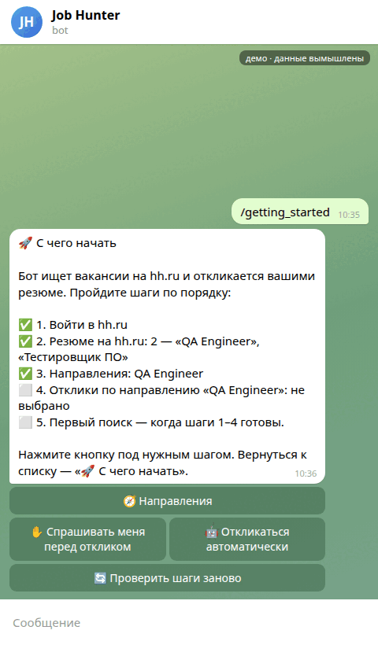

# Job Hunter

**A Telegram bot that searches hh.ru, SuperJob, Habr Career and GeekJob, explains why each vacancy fits, and can apply for you, with your approval by default.**

[](https://github.com/shizzka/job-hunter/actions/workflows/offline-tests.yml)   [](LICENSE)

Русская версия: [README.ru.md](README.ru.md)

<p align="center">
  
  <br><sub>Demo, made-up data. Texts and buttons are the bot's real ones.</sub>
</p>

- **You decide, the bot does the routine.** By default each vacancy arrives as a card: work format, fit score and the reason it fits. One tap and the bot applies with a cover letter. Fully automatic applying is a setting you switch on yourself.
- **Noise goes before the AI.** Office or hybrid jobs for a remote-only search, the wrong profession, blacklisted companies — cut by plain filters first, so the AI only scores what is worth reading.
- **It does not make things up.** Cover letters, questionnaire answers and HR chat replies use only facts from your resume and confirmed answers. Unknown stays unknown.
- **Several careers in one profile.** Search directions (say, QA and electrician) each have their own resumes, queries, filters and application mode.

> «The bot finds vacancies better than I do» — the first user, searching for remote-only work.

**Who makes it.** The author is an electrician, not a programmer. The code is written by AI agents (Claude Code and Codex); the author sets the tasks, tests the bot as a user and decides what gets released. AI writes, a human designs and checks: about 7,000 offline tests run in CI on every push, an AI tester goes through the dev bot every night like a real person, and the bot runs daily for two real job searches. When it cannot prove an action is safe, it stops and asks.

**Current version:** `v0.10.1` (2026-10-24): the bot no longer hangs on heavy commands (10 identical commands in a row: 127 s → ~9 s), work format and plain-words fit on every card, a strict «remote only» filter, plain-language texts. See [CHANGELOG](CHANGELOG.md).

## How it decides

Typical auto-apply chases volume:

```text
vacancy -> rewrite resume -> apply -> apply -> apply
```

Job Hunter optimizes the decision, not the application count:

```text
job boards
    ↓
search + dedupe
    ↓
deterministic filters
    ↓
LLM matcher
    ↓
candidate facts / resume / knowledge base
    ↓
decision
   ↙      ↘
skip    manual review / apply
               ↓
        safety guards
               ↓
        platform adapter
               ↓
            analytics
```

## Capabilities

| Capability | Status |
| --- | --- |
| Multi-source vacancy search and dedupe | ✅ |
| Several search directions per profile (resumes, queries, filters, regions) | ✅ |
| LLM vacancy matching | ✅ |
| Deterministic pre-filters before LLM calls | ✅ |
| Grounded cover-letter generation (template only after the owner's decision) | ✅ |
| Exact HH resume selection before submit | ✅ |
| hh.ru employer questionnaires; unanswerable questions asked once and remembered | ✅ |
| Google Forms from recruiter chats with preview-before-submit | ✅ |
| Telegram control plane, command queue and human approval paths | ✅ |
| Review list with paging, score sorting and bulk dismiss | ✅ |
| HH chat drafts grounded in the resume the application was sent with | ✅ |
| Isolated candidate profiles | ✅ |
| Application funnel, resume A/B, vacancy market snapshots and analytics | ✅ |
| Structured HH application traces | ✅ |
| Multi-provider LLM fallback | ✅ |
| Learning search queries from 👍/👎 feedback | 🚧 collecting data |
| Controlled Resume Tailoring | ⏸ paused |

## Supported sources

| Source | Search | Details | Auto-apply | Maturity |
| --- | --- | --- | --- | --- |
| hh.ru | ✅ | ✅ | ✅ | primary, live-tested |
| GeekJob | ✅ | ✅ | ✅ | beta, guarded |
| SuperJob | ✅ | ✅ | ✅ | beta |
| Habr Career | ✅ | ✅ | ✅ | beta, DOM-dependent |

External sites change DOM, APIs and anti-bot behavior without notice. Adapter support does not mean equal maturity across all platforms.

## Safety-first behavior

Job Hunter aims to **stop when it cannot prove an automated action is safe**.

Core rules:

- unknown candidate facts stay unknown;
- vacancy requirements are not treated as proof of candidate experience;
- inferred / weak facts are not promoted to confirmed experience;
- an ambiguous or unverified HH resume blocks submission;
- LLM/provider failures become `deferred_unscored`, not fake semantic rejection;
- stale drafts, approvals or form revisions block submit;
- profile state, cookies, resume, facts and analytics are isolated;
- risky or ambiguous external actions fall back to manual review where possible;
- private runtime artifacts stay outside the repository.

See [Architecture](docs/ARCHITECTURE.md), [Account & submission safety](docs/ACCOUNT_SUBMISSION_SAFETY.md), and [Answer grounding](docs/ANSWER_GROUNDING_AND_ANALYSIS.md).

## Quick start

### 1. Install

```bash
git clone https://github.com/shizzka/job-hunter.git
cd job-hunter

python3 -m venv venv
source venv/bin/activate

pip install -r requirements.txt
playwright install chromium
```

### 2. Configure

```bash
mkdir -p ~/.job-hunter
cp job-hunter.env.example ~/.job-hunter/job-hunter.env
```

At minimum configure an OpenAI-compatible LLM provider:

```env
LLM_BASE_URL=https://your-provider.example/v1
JOB_HUNTER_LLM_KEY=your-key
LLM_MODEL=your-model
```

Telegram and additional job boards are optional.

### 3. Run the setup wizard

```bash
./run.sh setup
```

### 4. Start with dry-run

```bash
./run.sh dry-run
```

### 5. Run a real search

```bash
./run.sh search
```

## AI-assisted setup

If you use a coding agent, give it:

> Clone https://github.com/shizzka/job-hunter and follow SETUP_AGENT.md step by step. Ask before any operation that logs in, submits an application, sends Telegram messages, or changes production configuration.

Full guide: [SETUP_AGENT.md](SETUP_AGENT.md).

## Main commands

```bash
# Profiles
./run.sh setup
./run.sh profiles
./run.sh --profile qa dry-run
./run.sh --profile qa search

# Login
./run.sh login
./run.sh superjob-login
./run.sh habr-login
./run.sh geekjob-login

# Resume and candidate facts
./run.sh grab-resume
./run.sh analyze-resume
./run.sh extract-facts

# Analytics
./run.sh stats
./run.sh analytics
./run.sh digest

# HH chats
./run.sh chat-respond

# Services
./run.sh daemon
./run.sh bot
./run.sh status
```

See [Operations](docs/OPERATIONS.md) and [job-hunter.env.example](job-hunter.env.example) for the full command/config reference.

## LLM providers

Job Hunter uses OpenAI-compatible APIs and supports provider fallback chains.

Task-specific model overrides:

```env
HH_MATCHER_MODEL=
HH_COVER_LETTER_MODEL=
HH_QUESTION_MODEL=
HH_CHOICE_MODEL=
HH_FACTS_EXTRACT_MODEL=
HH_CHAT_RESPONDER_MODEL=
HH_CAPTCHA_VISION_MODEL=
```

Empty values fall back to `LLM_MODEL`.

The temporary LAN Ollama path is an emergency compatibility mechanism, not the target architecture. Gateway product requirements and migration ownership now live in [AI Gateway](https://github.com/shizzka/ai-gateway); Job Hunter keeps its current fallback behavior until that migration is verified.

## Candidate profiles

Each profile owns its own:

```text
resume
facts
knowledge base
cookies
seen history
manual queues
analytics
runtime state
debug traces
```

Default locations:

```text
~/.job-hunter/
~/.job-hunter/profiles/<name>/
```

Named profiles must not inherit another candidate's biography, salary expectations, contacts or resume IDs.

## Candidate knowledge base

Confirmed candidate information can be stored in `knowledge/*.md`.

Before generating text, Job Hunter selects relevant sections and combines them with the current resume and structured facts. Vacancy text is treated as requirements/context, never as evidence that the candidate has a skill or experience.

## Setup in Telegram

<p align="center">
  
  <br><sub>Demo, made-up data.</sub>
</p>

`/getting_started` shows where you are: hh.ru login, resumes, search directions, application mode, first search. Each step has its button.

## Telegram

Telegram acts as a control plane for workflows where human review is useful:

- search directions (what to look for, which resumes, regions, application mode);
- review list: best matches first, paging, bulk dismiss, 👍/👎 feedback;
- yellow-zone applications and a command queue instead of «busy»;
- employer questions the bot cannot answer — asked once, the answer is remembered;
- chat-reply drafts with approval; rejections arrive as one digest;
- Google Form editing;
- captcha bridge;
- profile controls, vacancy market snapshots, monitoring and analytics.

Risky workflows should require explicit confirmation or fail closed.

## Analytics

Job Hunter records a local event funnel:

```text
found
→ filtered
→ matched
→ applied/manual/deferred
→ viewed
→ rejected/positive
→ interview/test task/offer
```

Where available, it also records requested/selected resume metadata, apply mode, match score, provider/model metadata and local resume hashes.

The point is to measure not just application count, but filtering quality, resume performance and conversion.

## Tests and CI

The regular test suite must not perform real applications, Telegram sends or external submits.

```bash
python -m pytest -q
```

GitHub Actions runs the isolated offline regression suite. Browser regressions use synthetic pages with Chromium.

Live acceptance checks are separate and explicitly authorized.

## State and privacy

Runtime state lives outside Git and may include:

- cookies and auth state;
- resume / facts / knowledge;
- `seen_vacancies.json`;
- analytics journals;
- queues and approval state;
- screenshots / HTML traces;
- Google Form previews;
- chat state.

Runtime artifacts can contain personal data. Review and redact them before attaching traces to public issues.

## Known limitations

- DOM drift can break hh.ru, Habr Career and other browser integrations.
- CAPTCHA and anti-bot handling are not guaranteed.
- LLM grounding reduces hallucination risk but cannot mathematically prove truth.
- Existing HH responses do not always reveal which resume was originally submitted.
- Exactly-once delivery cannot always be proven for external actions.
- Non-HH integrations have less live coverage than the primary HH workflow.
- The offline audit did not certify live third-party platform compatibility.

## Development status

Releases and what changed in each: [CHANGELOG.md](CHANGELOG.md). Development happens on the `dev` branch;
every change passes the full offline suite before it reaches the running bot.

New abstractions should solve repeated real failure modes, not exist merely because another subsystem can be invented.

## Documentation

- [Architecture](docs/ARCHITECTURE.md)
- [Operations](docs/OPERATIONS.md)
- [Account & submission safety](docs/ACCOUNT_SUBMISSION_SAFETY.md)
- [Answer grounding](docs/ANSWER_GROUNDING_AND_ANALYSIS.md)
- [Google Forms editing](docs/GOOGLE_FORM_EDITING.md)
- [Publication notes](docs/PUBLICATION.md)
- [Changelog](CHANGELOG.md)

## License

MIT. See [LICENSE](LICENSE).
